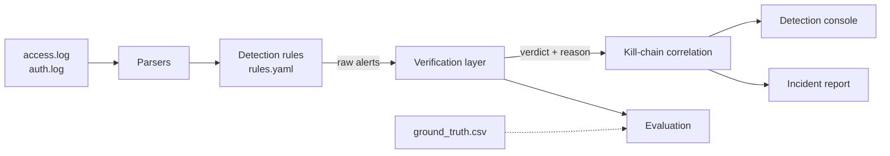

# VFDE: Verification-First Detection Engine

A defensive log-analysis engine for SOC triage. VFDE detects suspicious activity
in web and SSH authentication logs, **verifies each alert against evidence in
the logs** to suppress false positives, and correlates what remains into
kill-chain incidents mapped to MITRE ATT&CK.


---

## Why

Rule-based detection is noisy. A search for `O'Brien` matches a SQL injection
pattern; a user who mistypes a password five times looks like a brute-force
attack; a browser requesting missing images looks like directory enumeration.
Analysts spend most of their time dismissing alerts like these.

VFDE treats a rule match as a *hypothesis*, not a finding. Every alert is
checked against what the logs actually show (server response, timing, volume,
outcome) and given a verdict with a written reason. Only alerts that survive
verification reach the analyst, grouped into one incident per attacker.

## Features

- **Parsing**: nginx access logs (combined format, optional `$request_time`)
  and Linux `auth.log` (sshd, sudo), with URL decoding and an unparsed-line count.
- **Detection**: 9 configurable rules with sliding time windows, each mapped
  to a MITRE ATT&CK technique. Thresholds and patterns live in `rules.yaml`.
- **Verification**: four verdicts (`Confirmed`, `Likely`, `Attempted`,
  `Noise`) with a confidence score and a human-readable reason for each alert.
- **Correlation**: alerts from one source are joined into incidents spanning
  Reconnaissance → Initial Access → Compromise → Post-Exploitation, with
  severity escalation for multi-stage activity.
- **Governance context**: each incident lists related ISO/IEC 27001:2022
  Annex A controls and RBI Cyber Security Framework control areas, plus
  prioritised response recommendations.
- **Detection console**: Streamlit dashboard with an incident queue, incident
  timelines, an alert explorer, coverage and evaluation views.
- **Incident report**: self-contained HTML report, printable to PDF.
- **Evaluation**: reproducible precision / recall / false-positive measurement
  against labelled data.

## Architecture



The verifier never reads the ground truth; only the evaluation does.

## Results

Measured on the bundled **labelled synthetic dataset** (3,434 events, 18
labelled attack episodes, benign traffic that includes deliberate look-alikes):

| Metric | Raw rules | After verification |
|---|---|---|
| Alerts | 162 | 59 |
| False positives | 104 | 1 |
| Alert precision | 35.8% | 98.3% |
| Episode recall | 100% | 100% |
| Incidents | n/a | 15 (3 multi-stage) |

Five further synthetic seeds give a 98–100% false-positive reduction with full
recall. Full breakdown, per-technique results and the matching rules used:
[docs/results.md](docs/results.md).

> These figures come from synthetic data generated alongside the verifier, so
> they are a controlled benchmark rather than a measure of real-world
> performance. Expect lower precision on production logs.

## Quick start

Requires Python 3.10+.

```bash
git clone https://github.com/gupta-ashwani/VFDE.git
cd VFDE
pip install -r requirements.txt

streamlit run app.py              # detection console at http://localhost:8501
```

The console loads `sample_logs/` by default. Switch to **Upload logs** in the
sidebar to analyse your own files.


## Command-line usage

```bash
# Regenerate the labelled sample dataset
python generators/synthetic_logs.py --out sample_logs --seed 7 --year 2025

# Detect, verify and correlate; print incidents with timelines and controls
python cli.py analyze --logs sample_logs --correlate --show

# Write the HTML incident report to reports/incident_report.html
python cli.py report --logs sample_logs

# Full evaluation, including robustness across fresh synthetic seeds
python eval.py --logs sample_logs --seeds 1 2 3 11 42 --write docs/results.md
```

## How verification works

| Verdict | Meaning | Example evidence |
|---|---|---|
| **Confirmed** | Activity succeeded or had impact | HTTP 5xx on injected input; response far above the clean baseline; time-based delay; login success after scripted guessing |
| **Likely** | Strong malicious signal, impact not proven | Repeated probes in a burst; scanner user-agent alongside enumeration |
| **Attempted** | Malicious-looking, no sign it worked | Scripted password guessing with no successful login |
| **Noise** | Matches a rule but behaves like legitimate traffic | Isolated look-alike query; human-paced typos for one user; 404 burst on static assets; health-check monitor |

Design points:

- Response-size baselines are built only from sources that triggered no rule.
- Pattern matches are judged as bursts per source, not single requests.
- Verification runs in two passes so an alert already judged `Noise` can never
  corroborate another alert.
- Reflected XSS cannot be confirmed from server logs and is capped at `Attempted`.

## Detection rules

| Rule | Technique | Kill-chain stage |
|---|---|---|
| SSH brute force | T1110 Brute Force | Initial Access |
| Login success after failures | T1078 Valid Accounts | Compromise |
| 404 burst (enumeration) | T1595 Active Scanning | Reconnaissance |
| Scanner user-agent | T1595 Active Scanning | Reconnaissance |
| SQL injection pattern | T1190 Exploit Public-Facing Application | Initial Access |
| XSS pattern | T1190 Exploit Public-Facing Application | Initial Access |
| Path traversal | T1083 File and Directory Discovery | Initial Access |
| Off-hours login | T1078 Valid Accounts | Compromise |
| Repeated sudo failures | T1068 Exploitation for Privilege Escalation | Post-Exploitation |

## Project structure

```
vfde/
├── app.py                    Streamlit detection console
├── cli.py                    analyze / report commands
├── eval.py                   evaluation and seed sweep
├── rules.yaml                detection, verification and correlation settings
├── vfde/
│   ├── parsers/              nginx and auth.log parsers
│   ├── detections/           rule engine
│   ├── verification/         baselines and per-rule verifiers
│   ├── correlation/          kill-chain incident builder
│   ├── mapping/              MITRE ATT&CK and ISO 27001 / RBI CSF mappings
│   ├── reporting/            HTML incident report
│   └── pipeline.py           shared parse → detect → verify → correlate entry point
├── generators/               labelled synthetic log generator
├── sample_logs/              bundled dataset with ground truth
├── lab/                      Docker lab configuration (experimental)
├── docs/                     results and screenshots
└── tests/                    unit and integration tests
```

## Testing

```bash
pytest -q
```

Tests cover the parsers, every detection rule (positive and negative cases),
each verifier, correlation behaviour, the evaluation maths, and HTML escaping
of log-derived content in the report.

## Limitations

- Batch analysis of log files; not a real-time SIEM.
- Two log sources only (nginx access, Linux auth).
- Validated on synthetic data; the Docker lab in `lab/` is experimental and
  not yet used for validation.
- The compliance mapping indicates which controls the evidence relates to. It
  is not a compliance assessment. RBI CSF entries are control areas by name;
  clause references should be checked against the official circular.

## Roadmap

- Validation on logs captured from the isolated Docker lab
- Near-real-time mode: log tailing, streaming windows, alert lifecycle
- Sigma rule import
- IP reputation and GeoIP enrichment

## Disclaimer

For defensive and educational use. All testing was performed on locally
generated logs; only run attack tooling against systems you own or are
authorised to test.
