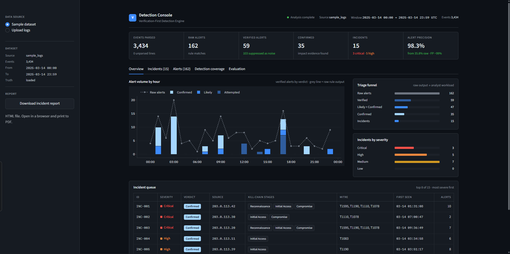
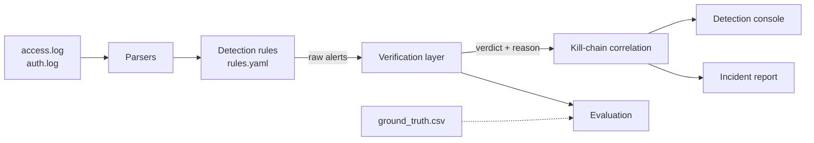
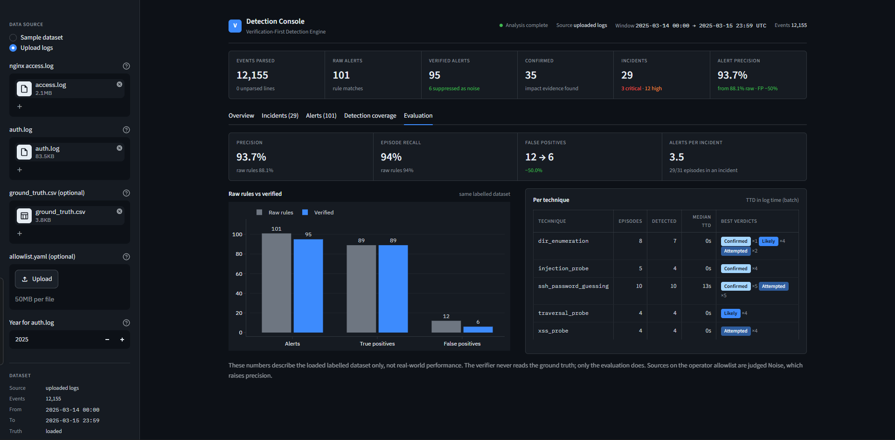
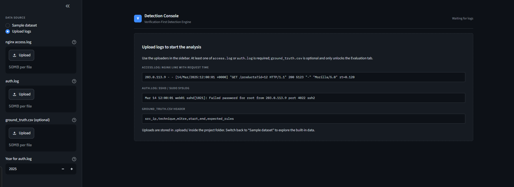

# VFDE: Verification-First Detection Engine

A defensive log-analysis engine for SOC triage. VFDE detects suspicious activity
in web and SSH authentication logs, **verifies each alert against evidence in
the logs** to suppress false positives, and correlates what remains into
kill-chain incidents mapped to MITRE ATT&CK.



---

## Why

Rule-based detection is noisy. A search for `O'Brien` matches a SQL injection
pattern; a user who mistypes a password five times looks like a brute-force
attack; a browser requesting missing images looks like directory enumeration.
Analysts spend most of their time dismissing alerts like these.

VFDE treats a rule match as a *hypothesis*, not a finding. Every alert is
checked against what the logs actually show (server response, timing, volume,
outcome) and given a verdict with a written reason. Only alerts that survive
verification reach the analyst, grouped into one incident per attacker.

## Features

- **Parsing**: nginx access logs (combined format, optional `$request_time`)
  and Linux `auth.log` (sshd, sudo), with URL decoding and an unparsed-line count.
- **Detection**: 11 configurable rules with sliding time windows, each mapped
  to a MITRE ATT&CK technique. Thresholds, patterns and an operator allowlist
  of known, authorised sources live in `rules.yaml` / `allowlist.yaml`.
- **Verification**: four verdicts (`Confirmed`, `Likely`, `Attempted`,
  `Noise`) with a confidence score and a human-readable reason for each alert.
- **Correlation**: alerts from one source are joined into incidents spanning
  Reconnaissance → Initial Access → Compromise → Post-Exploitation, with
  severity escalation for multi-stage activity.
- **Governance context**: each incident lists related ISO/IEC 27001:2022
  Annex A controls and RBI Cyber Security Framework control areas, plus
  prioritised response recommendations.
- **Detection console**: Streamlit dashboard with an incident queue, incident
  timelines, an alert explorer, coverage and evaluation views.
- **Incident report**: self-contained HTML report, printable to PDF.
- **Evaluation**: reproducible precision / recall / false-positive measurement
  against labelled data.

## Architecture



The verifier never reads the ground truth; only the evaluation does.

## Results

VFDE is evaluated on two labelled datasets. Neither is production traffic.

### 1. Lab dataset: the more meaningful test

Author-labelled logs from attack scenarios run in a local lab (12,155 events,
31 labelled episodes, plus eight deliberate benign "gotchas": an uptime
monitor, a search-engine crawler, a user mistyping a password, searches
containing SQL/HTML-looking words, missing-image 404s, application 500 errors,
an on-call admin at 03:17 and an authorised internal vulnerability scan).

The first run was a **hold-out**: the rules and verifier had never seen this
data and were not changed before the numbers were recorded. It exposed real
gaps, which were then fixed (see below). Both sets of numbers are kept:

| Metric (verified alerts) | Before fixes (frozen hold-out) | After fixes | After fixes + operator allowlist |
|---|---|---|---|
| Alerts (raw → verified) | 79 → 72 | 101 → 95 | 101 → 89 |
| Episode recall | 67.7% | 93.5% | 93.5% |
| Alert precision | 93.1% | 93.7% | 100% |
| False positives (raw → verified) | 11 → 5 | 12 → 6 | 12 → 0 |
| Precision of `Confirmed` alerts | 89.7% | 91.4% | 100% |
| Incidents (false incidents) | 19 (1) | 29 (1) | 28 (0) |
| Raw alerts per incident | 4.2 | 3.5 | 3.6 |

Raw rules alone reached 71.0% recall before the fixes, so the verifier had also
suppressed a real attack (a single `<script>alert(1)</script>` request).



*Dashboard Evaluation tab with the lab dataset uploaded and no allowlist, matching the "After fixes" column.*

What the hold-out run found, and what changed:

| Finding | Fix |
|---|---|
| Slow SSH guessing (about one try every 5 minutes across 7-10 usernames) never formed a 60-second burst | New `slow_brute_force` rule: many failures **and** many distinct usernames from one IP in an hour |
| Small directory sweeps stayed under the 404-count threshold; `dirb` was not a known scanner | New `sensitive_path_probe` rule (distinct refused sensitive paths such as `/.git/HEAD`, `/backup.zip`); larger scanner user-agent list |
| Verifier dismissed a lone executable XSS payload as "a user discussing markup" | Single XSS strings carrying an executable payload (`alert(`, `onerror=`, `javascript:`) are now `Attempted` |
| An authorised internal scanner produced every remaining false positive | Operator allowlist (`allowlist.yaml`): allowlisted sources are judged `Noise` with a visible reason |

**Caveat:** the fixes were designed after seeing this dataset, so the
"after" columns are no longer hold-out results. They should be re-checked on a
fresh dataset. Two episodes are still missed on purpose: a two-request scan and
a lone apostrophe in a query. Catching them would flag ordinary users (for
example a search for `alice's book`). The allowlist column assumes the operator
has told the tool about the authorised scanner; without it, that source stays a
false positive.

Reproduce: `python eval.py --logs external_logs/lab_v2 --match window` (add
`--no-allowlist` to ignore `allowlist.yaml`). Frozen and post-fix reports:
[before](docs/results_lab_v2_prefix.md),
[after](docs/results_lab_v2_postfix.md),
[after + allowlist](docs/results_lab_v2_postfix_allowlist.md).

### 2. Bundled synthetic dataset

3,434 events, 18 labelled episodes, benign traffic with deliberate look-alikes,
generated by `generators/synthetic_logs.py`:

| Metric | Raw rules | After verification |
|---|---|---|
| Alerts | 167 | 64 |
| False positives | 104 | 1 |
| Alert precision | 37.7% | 98.4% |
| Episode recall | 100% | 100% |
| Incidents | n/a | 15 (3 multi-stage) |

Five further synthetic seeds give a 98-100% false-positive reduction with full
recall ([docs/results.md](docs/results.md)).

> The generator, the benign look-alikes and the verifier were written together,
> so this dataset is a controlled benchmark that flatters the tool. Treat the
> lab dataset as the more honest number, and expect lower precision on
> production logs.

## Quick start

Requires Python 3.10+.

```bash
git clone https://github.com/gupta-ashwani/VFDE.git
cd VFDE
pip install -r requirements.txt

streamlit run app.py              # detection console at http://localhost:8501
```

The console loads `sample_logs/` by default. Switch to **Upload logs** in the
sidebar to analyse your own files.



## Command-line usage

```bash
# Regenerate the labelled sample dataset
python generators/synthetic_logs.py --out sample_logs --seed 7 --year 2025

# Detect, verify and correlate; print incidents with timelines and controls
python cli.py analyze --logs sample_logs --correlate --show

# Write the HTML incident report to reports/incident_report.html
python cli.py report --logs sample_logs

# Full evaluation, including robustness across fresh synthetic seeds
python eval.py --logs sample_logs --seeds 1 2 3 11 42 --write docs/results.md

# Evaluate any labelled dataset (ground_truth.csv with src_ip, technique, start, end)
python eval.py --logs external_logs/lab_v2 --match window
```

## How verification works

| Verdict | Meaning | Example evidence |
|---|---|---|
| **Confirmed** | Activity succeeded or had impact | HTTP 5xx on injected input; response far above the clean baseline; time-based delay; login success after scripted guessing |
| **Likely** | Strong malicious signal, impact not proven | Repeated probes in a burst; scanner user-agent alongside enumeration |
| **Attempted** | Malicious-looking, no sign it worked | Scripted password guessing with no successful login |
| **Noise** | Matches a rule but behaves like legitimate traffic | Isolated look-alike query; human-paced typos for one user; 404 burst on static assets; health-check monitor |

Design points:

- Response-size baselines are built only from sources that triggered no rule.
- Pattern matches are judged as bursts per source, not single requests.
- Verification runs in two passes so an alert already judged `Noise` can never
  corroborate another alert.
- Reflected XSS cannot be confirmed from server logs and is capped at `Attempted`.
  A lone XSS-looking string is `Noise` unless it carries an executable payload.
- Allowlisted sources are judged `Noise` with the operator's reason shown, so
  the suppression stays auditable. The tool cannot know a scanner is authorised
  unless it is told.

## Detection rules

| Rule | Technique | Kill-chain stage |
|---|---|---|
| SSH brute force (burst) | T1110 Brute Force | Initial Access |
| Slow brute force (many usernames over an hour) | T1110 Brute Force | Initial Access |
| Login success after failures | T1078 Valid Accounts | Compromise |
| 404 burst (enumeration) | T1595 Active Scanning | Reconnaissance |
| Sensitive-path sweep (`/.git`, `/backup.zip`, `/admin`...) | T1595 Active Scanning | Reconnaissance |
| Scanner user-agent | T1595 Active Scanning | Reconnaissance |
| SQL injection pattern | T1190 Exploit Public-Facing Application | Initial Access |
| XSS pattern | T1190 Exploit Public-Facing Application | Initial Access |
| Path traversal | T1083 File and Directory Discovery | Initial Access |
| Off-hours login | T1078 Valid Accounts | Compromise |
| Repeated sudo failures | T1068 Exploitation for Privilege Escalation | Post-Exploitation |

## Project structure

```
vfde/
├── app.py                    Streamlit detection console
├── cli.py                    analyze / report commands
├── eval.py                   evaluation and seed sweep
├── rules.yaml                detection, verification and correlation settings
├── vfde/
│   ├── parsers/              nginx and auth.log parsers
│   ├── detections/           rule engine
│   ├── verification/         baselines and per-rule verifiers
│   ├── correlation/          kill-chain incident builder
│   ├── mapping/              MITRE ATT&CK and ISO 27001 / RBI CSF mappings
│   ├── reporting/            HTML incident report
│   └── pipeline.py           shared parse → detect → verify → correlate entry point
├── generators/               labelled synthetic log generator
├── sample_logs/              bundled synthetic dataset with ground truth
├── external_logs/lab_v2/     lab dataset: logs, ground truth, benign gotchas, allowlist
├── lab/                      Docker lab configuration (experimental)
├── docs/                     results and screenshots
└── tests/                    unit and integration tests
```

## Testing

```bash
pytest -q
```

Tests cover the parsers, every detection rule (positive and negative cases),
each verifier, correlation behaviour, the evaluation maths, and HTML escaping
of log-derived content in the report.

## Limitations

- Batch analysis of log files; not a real-time SIEM.
- Two log sources only (nginx access, Linux auth).
- Validated on two small labelled datasets (one synthetic, one author-labelled
  from a local lab), never on production traffic. Post-fix numbers on the lab
  dataset are not hold-out results.
- Low-and-slow and very small probes remain hard: a two-request scan or a lone
  apostrophe is not flagged because doing so would flag ordinary users.
- The Docker lab in `lab/` is experimental.
- The compliance mapping indicates which controls the evidence relates to. It
  is not a compliance assessment. RBI CSF entries are control areas by name;
  clause references should be checked against the official circular.

## Roadmap

- Re-validate the fixes on a fresh, unseen dataset
- Validation on logs captured from a real or production-like service
- Near-real-time mode: log tailing, streaming windows, alert lifecycle
- Sigma rule import
- IP reputation and GeoIP enrichment

## Disclaimer

For defensive and educational use. All testing was performed on locally
generated logs; only run attack tooling against systems you own or are
authorised to test.
